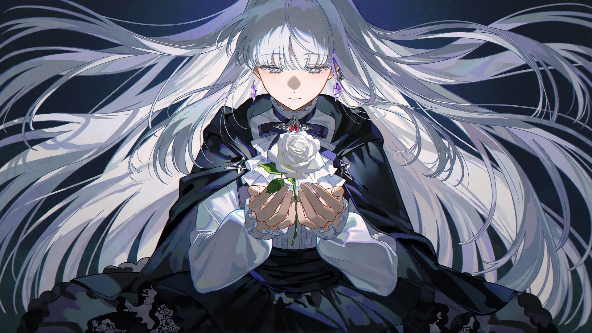

# anime-illustration

[中文文档](README.zh-CN.md) · [License](LICENSE) · Python 3.11+ · ComfyUI 0.42+

Anime character illustrations from a written brief or reference images — rendered **locally** with Krea 2 Turbo in ComfyUI, then refined with a **pick-and-fix loop**: render candidates → pick one → freeze it → change one spot at a time with masked inpainting while everything else stays pixel-identical.

Packaged both as a **coding-agent skill** (drop it into Claude Code / Codex / any agent that reads `SKILL.md`) and as a **standalone CLI toolkit** you can drive by hand.



## Why this exists

Text-to-image gives you a lottery: re-prompt for one small change and the whole picture re-lays out. This repo encodes a working loop that treats renders as drafts:

1. **Pin the character down from references** — not from the model's memory (see the [prompting guide](references/prompting-krea2.md#identity-block)).
2. **Confirm the render config with a checklist** (workflow, base model, LoRA, style line, aspect ratio, resolution — all pre-ticked with defaults; say "defaults" or tick what to change).
3. **Render 2–3 seeds**, review every image, send a labeled comparison grid.
4. **Freeze the pick** into a re-renderable preset and verify bit-exact reproduction.
5. **Fix single spots** with masked local inpaint — a missing prop, an extra digit, a garbled signature — without touching the rest.

## What's in the box

| Part | What it does |
|---|---|
| 3 ComfyUI workflows (API format) | plain Turbo · Turbo + style LoRA · masked local inpaint |
| 7 scripts | submit/render/queue, comparison grids, preset freezing, pixel-diff verification, mask compositing, SAM 2.1 masking, model download + SHA-256 verification |
| Prompting guide | the Krea 2 rules that actually change outcomes (no artist names, no negative prompt, small-prop survival, hands, signatures, lighting) |
| Local-fix playbook | a field-tested table of what worked and what didn't for one-spot repairs |
| Worked example | [adding the missing bubble gum](examples/nira_china_bubble_fix/README.md), file by file |
| LoRA library doc | sources, tested strengths and hashes for each style LoRA (files not redistributed) |
| Model manifest | exact filenames, sizes, sources and SHA-256 hashes for every model |

## Requirements

| | |
|---|---|
| GPU | 6 GB VRAM tested (RTX 3060 Laptop); larger is fine |
| RAM | 16 GB workable, 32 GB comfortable — **RAM, not VRAM, is the usual bottleneck** |
| OS | Windows 11 (tested); Linux/macOS should work, scripts are plain Python |
| ComfyUI | 0.42.0+ with the [ComfyUI-GGUF](https://github.com/city96/ComfyUI-GGUF) custom node |
| Python | 3.11+ (the ComfyUI venv itself for `sam_mask.py`) |

## Install

### 1 · ComfyUI + custom node

```bash
git clone https://github.com/comfyanonymous/ComfyUI && cd ComfyUI
python -m venv venv && venv/Scripts/pip install -r requirements.txt   # Windows
git clone https://github.com/city96/ComfyUI-GGUF custom_nodes/ComfyUI-GGUF
venv/Scripts/pip install -r custom_nodes/ComfyUI-GGUF/requirements.txt
```

Start the server:

```bash
python main.py --listen 127.0.0.1 --port 8188 --lowvram --cpu-vae --disable-auto-launch
```

`--lowvram --cpu-vae` is the 6 GB-friendly profile; drop the flags on bigger GPUs.

### 2 · Models

Pick a models root (anywhere on disk), then:

```bash
python scripts/download_models.py --root D:/models
```

That downloads the Hugging Face-hosted files and verifies every SHA-256 against [`models/models.toml`](models/models.toml). Civitai-hosted LoRAs (z3zz4 and friends) need a free account — download them manually to the paths in the manifest, then re-run with `--check-only` to verify the hashes.

| Required | File | Size | Source |
|---|---|---|---|
| Base | `diffusion_models/krea2_turbo-Q4_K_M.gguf` | 7.0 GB | [HF](https://huggingface.co/vantagewithai/Krea-2-Turbo-GGUF) |
| Text encoder | `text_encoders/qwen3vl_4b_fp8_scaled.safetensors` | 4.9 GB | [HF](https://huggingface.co/Comfy-Org/Krea-2) |
| VAE | `vae/qwen_image_vae.safetensors` | 242 MB | [HF](https://huggingface.co/Comfy-Org/Krea-2) |
| Style LoRA | `loras/z3zz4-k2-4_c1-st5000.safetensors` | 448 MB | [Civitai](https://civitai.com/models/2750764) (manual) |

Optional models (faster base, more styles, SAM 2.1, anime cutout) are in the manifest and the [setup guide](references/setup.md).

### 3 · Wire the models root into ComfyUI

Copy [`extra_model_paths.yaml.example`](extra_model_paths.yaml.example) next to `main.py` as `extra_model_paths.yaml`, point `base_path` at your models root, restart ComfyUI.

> **Filenames matter.** The workflows load `krea2_turbo-Q4_K_M.gguf`, `qwen3vl_4b_fp8_scaled.safetensors`, `qwen_image_vae.safetensors` and `z3zz4-k2-4_c1-st5000.safetensors` by name. Keep those filenames or edit the loader nodes in the JSON.

### 4 · Install as a skill (or use standalone)

```bash
# Claude Code
git clone https://github.com/<you>/anime-illustration ~/.claude/skills/anime-illustration

# Cross-agent skills dir (Codex and friends)
git clone https://github.com/<you>/anime-illustration ~/.agents/skills/anime-illustration
```

Or don't install anything — the `scripts/` folder is a plain CLI toolkit:

```bash
python scripts/run_workflow.py --help
```

### 5 · Smoke test

```bash
echo "a crimson-haired anime girl holding a baguette, crisp linework, soft painterly shading" > /tmp/first.txt
python scripts/run_workflow.py assets/workflows/krea2_turbo_z3zz4_api.json \
    --prompt-file /tmp/first.txt --seed 1234 --prefix smoke \
    --output-dir <ComfyUI>/output
```

A real Turbo render takes minutes. If ComfyUI reports "model not found", see [troubleshooting](docs/troubleshooting.md#model-not-found-when-the-workflow-runs).

## Usage — the full loop

```bash
# 1. render 2–3 seeds (~4–5 min each on the reference 6 GB laptop)
for s in 1234 20261030 3120095504871; do
  python scripts/run_workflow.py assets/workflows/krea2_turbo_z3zz4_api.json \
      --prompt-file my_prompt.txt --seed $s --prefix nira_s$s --output-dir <ComfyUI>/output
done

# 2. look at them side by side, then send the grid for review
python scripts/compare.py compare/nira_grid.jpg \
    "s1234=<ComfyUI>/output/nira_s1234_00001_.png" \
    "s20261030=<ComfyUI>/output/nira_s20261030_00001_.png" \
    --cols 2 --width 960

# 3. the pick comes back ("this one") — freeze it into a re-renderable preset
python scripts/freeze_preset.py <ComfyUI>/output/nira_s1234_00001_.png presets/nira_v1 --note "picked"

# 4. prove the preset reproduces bit-exactly (unload models first so cache can't fake it)
curl -X POST http://127.0.0.1:8188/free -d '{"unload_models": true, "free_memory": true}'
python scripts/run_workflow.py presets/nira_v1/workflow_api.json --as-is --prefix verify
python scripts/pixel_diff.py presets/nira_v1/best.png <ComfyUI>/output/verify_00001_.png

# 5. one spot wrong? mask it, inpaint only that, paste it back
python scripts/run_workflow.py assets/workflows/krea2_turbo_z3zz4_local_inpaint_api.json \
    --prompt-file fix_bubble.txt --image presets/nira_v1/best.png --mask fix_mask.png \
    --denoise 0.98 --seed 202 --upload
python scripts/composite_mask.py presets/nira_v1/best.png <output> fix_mask.png fixed.png
```

A complete, file-by-file walkthrough of step 5: [examples/nira_china_bubble_fix](examples/nira_china_bubble_fix/README.md). Gallery with recipes: [docs/gallery.md](docs/gallery.md).

## The render-config checklist

When used as a skill, after you state the character setup the agent shows the render config once as a checkbox list — every default pre-ticked. Reply "defaults" (全默认) or tick what to change:

```
渲染配置（defaults pre-ticked, tick what to change）:
- [x] workflow:      krea2_turbo_z3zz4_api.json (style LoRA)
      [ ] krea2_turbo_plain_api.json        [ ] local inpaint
- [x] base model:    krea2_turbo-Q4_K_M.gguf
      [ ] redcraft23 (~3x faster, busier)   [ ] other GGUF
- [x] LoRA:          z3zz4 @ 0.95
      [ ] BArtstyle @ 0.75    [ ] Yoneyama_Mai @ 0.45    [ ] none    [ ] custom
- [x] style line:    carried by the LoRA (Krea 2 ignores artist names)
      [ ] flat-MV style descriptors    [ ] custom ________
- [x] aspect ratio:  16:9    [ ] 9:16    [ ] 1:1    [ ] other
- [x] resolution:    1920×1080 single pass    [ ] 1280×720    [ ] 2560×1440
```

## Prompting rules that matter

The full guide is [references/prompting-krea2.md](references/prompting-krea2.md); the three that surprise people most:

- **Artist names do nothing.** Style comes from a LoRA or concrete descriptors (line weight, shading, palette, grain).
- **There is no negative prompt.** The graphs run at CFG 1 with a zeroed negative. Put exclusions in the main text.
- **Small props get dropped** from long prompts. Put them early with a concrete size and position — or add them locally after picking.

## Character profiles

The skill keeps confirmed character designs in `references/characters.md` (gitignored — your OCs stay local). Start from [`references/characters.template.md`](references/characters.template.md). A filled example (Kasane Teto) is included.

## Repository layout

Every artifact type lives in its own folder and is documented:

```
anime-illustration/
├── SKILL.md                  the agent-facing workflow (install this folder as a skill)
├── agents/openai.yaml        interface metadata for OpenAI-style agent harnesses
├── assets/                   assets — style example + fix prompts (prompts/) and the 3 workflows (workflows/)
├── models/models.toml        models — manifest with filenames, URLs, SHA-256
├── loras/README.md           LoRA library — sources, tested strengths, hashes (files not redistributed)
├── references/               prompting guide · setup · local fixes · character template · scene-profile example
├── scripts/                  run_workflow · compare · freeze_preset · pixel_diff · composite_mask · sam_mask · download_models
├── examples/                 the bubble-gum fix, file by file (assets + mask + comparison + final)
└── docs/
    ├── final-frames/         final picked frames, each labeled with its recipe
    ├── comparisons/          before/after comparison images
    ├── gallery.md            gallery index
    └── troubleshooting.md    failure modes and fixes
```

## Troubleshooting

[docs/troubleshooting.md](docs/troubleshooting.md) covers the failure modes hit on the reference machine: renders slowing 4–10× from RAM paging, background loops that keep submitting jobs after being stopped, interrupting the wrong queue job, cache-faked reproducibility checks, and model-not-found.

## Credits & disclaimers

- Built on [ComfyUI](https://github.com/comfyanonymous/ComfyUI), [ComfyUI-GGUF](https://github.com/city96/ComfyUI-GGUF), and Krea 2 Turbo (Krea). Model sources are listed in [models/models.toml](models/models.toml).
- The z3zz4, BArtstyle and Yoneyama Mai style LoRAs are by their respective authors on Civitai and are **not** redistributed here — download them from the linked pages under their licenses.
- Gallery images featuring Kasane Teto and ZUTOMAYO characters are unofficial fan art. Teto is a free-to-use UTAU character. This project is not affiliated with Krea, AME/ZUTOMAYO, or any original creator.
- Code: [MIT](LICENSE). Model weights and LoRAs remain under their own licenses.

## Star history

If this saved you render-round trips, a star helps others find it.
