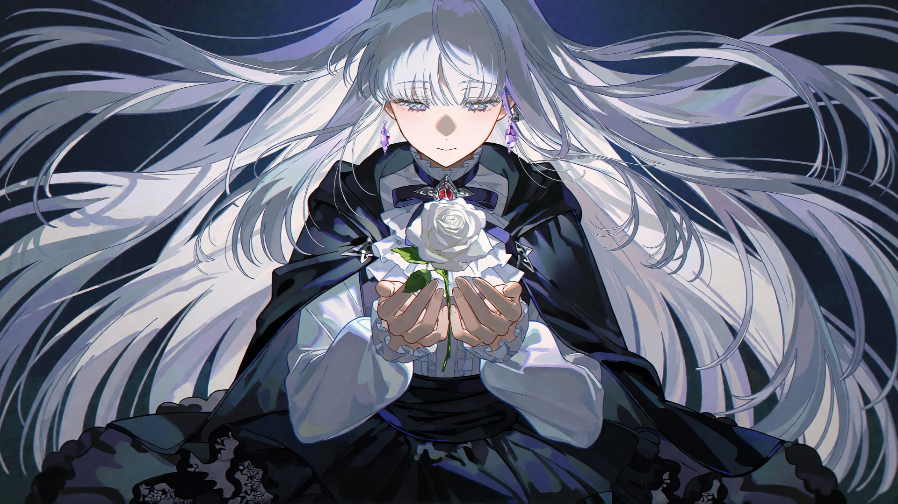

# anime-illustration

[English](README.md) · [中文文档](README.zh-CN.md) · MIT 协议 · Python 3.11+ · ComfyUI 0.42+

从文字设定或参考图出发生成二次元角色插画——用 **Krea 2 Turbo 在本地 ComfyUI 渲染**，再走一套**"选图—冻结—局部修复"闭环**：出多张候选 → 用户选一张 → 冻结成可复现的 preset → 用蒙版局部重绘一次只改一个点，其余部分像素级不变。

既可以作为**编码 agent 的 skill**（放进 Claude Code / Codex / 任何读 `SKILL.md` 的 agent），也可以当**独立命令行工具箱**手动驱动。



## 为什么做这个

文生图像抽卡：想改一个小细节，整张图重新排版。这个仓库沉淀了一套把渲染图当草稿的工作法：

1. **从参考图锁定角色外观**——不要靠模型的记忆猜（见[提示词指南](references/prompting-krea2.md)）。
2. **用打勾清单确认渲染配置**（工作流 / 底模 / LoRA / 风格串 / 比例 / 分辨率，默认项预勾选；回"全默认"或勾选要改的项）。
3. **跑 2–3 个种子**，逐张检查，拼好带标签的对比图再发。
4. **冻结选中的图**成可复现 preset，并做像素级复现验证。
5. **局部修复**单个问题——缺失的道具、多余的手指、乱码签名——其余部分不动。

## 仓库里有什么

| 组成 | 作用 |
|---|---|
| 3 个 ComfyUI 工作流（API 格式） | 纯 Turbo · Turbo+风格 LoRA · 蒙版局部重绘 |
| 7 个脚本 | 提交渲染/队列管理、对比图、preset 冻结、像素 diff 验证、蒙版合成、SAM 2.1 蒙版、模型下载+SHA-256 校验 |
| 提示词方法论 | 真正影响出图的 Krea 2 规则（画师名无效、无负面词、小道具保全、手部、签名、打光） |
| 局部修复手册 | 逐条记录"什么有效什么无效"的实战表格 |
| 完整案例 | [泡泡糖局部修复](examples/nira_china_bubble_fix/README.md)，逐文件拆解 |
| LoRA 说明 | 各风格 LoRA 的来源、实测强度与哈希（不分发文件本体） |
| 模型清单 | 每个模型的精确文件名、体积、来源和 SHA-256 |

## 硬件要求

| | |
|---|---|
| GPU | 实测 6 GB 显存（RTX 3060 Laptop）可用，更大更好 |
| 内存 | 16 GB 能跑，32 GB 舒服——**瓶颈通常是内存不是显存** |
| 系统 | Windows 11（实测）；Linux/macOS 理论可用，脚本都是纯 Python |
| ComfyUI | 0.42.0+，装 [ComfyUI-GGUF](https://github.com/city96/ComfyUI-GGUF) 自定义节点 |
| Python | 3.11+（`sam_mask.py` 用 ComfyUI 的 venv） |

## 安装

### 1 · ComfyUI + 自定义节点

```bash
git clone https://github.com/comfyanonymous/ComfyUI && cd ComfyUI
python -m venv venv && venv/Scripts/pip install -r requirements.txt   # Windows
git clone https://github.com/city96/ComfyUI-GGUF custom_nodes/ComfyUI-GGUF
venv/Scripts/pip install -r custom_nodes/ComfyUI-GGUF/requirements.txt
```

启动服务：

```bash
python main.py --listen 127.0.0.1 --port 8188 --lowvram --cpu-vae --disable-auto-launch
```

`--lowvram --cpu-vae` 是 6 GB 显存的保命配置；大显存显卡可以去掉。

### 2 · 模型

选一个模型根目录（放哪都行），然后：

```bash
python scripts/download_models.py --root D:/models
```

Hugging Face 上的文件会自动下载，并按 [`models/models.toml`](models/models.toml) 逐个校验 SHA-256。Civitai 上的 LoRA（z3zz4 等）需要免费账号手动下载到清单里的路径，然后 `--check-only` 复验哈希。

| 必需 | 文件 | 体积 | 来源 |
|---|---|---|---|
| 底模 | `diffusion_models/krea2_turbo-Q4_K_M.gguf` | 7.0 GB | [HF](https://huggingface.co/vantagewithai/Krea-2-Turbo-GGUF) |
| 文本编码器 | `text_encoders/qwen3vl_4b_fp8_scaled.safetensors` | 4.9 GB | [HF](https://huggingface.co/Comfy-Org/Krea-2) |
| VAE | `vae/qwen_image_vae.safetensors` | 242 MB | [HF](https://huggingface.co/Comfy-Org/Krea-2) |
| 风格 LoRA | `loras/z3zz4-k2-4_c1-st5000.safetensors` | 448 MB | [Civitai](https://civitai.com/models/2750764)（手动） |

可选模型（更快底模、更多风格、SAM 2.1、动漫抠图）见清单和[环境文档](references/setup.md)。

### 3 · 把模型根目录接进 ComfyUI

把 [`extra_model_paths.yaml.example`](extra_model_paths.yaml.example) 复制到 `main.py` 旁边改名 `extra_model_paths.yaml`，`base_path` 指向你的模型根目录，重启 ComfyUI。

> **文件名必须一致。** 工作流按文件名加载 `krea2_turbo-Q4_K_M.gguf`、`qwen3vl_4b_fp8_scaled.safetensors`、`qwen_image_vae.safetensors`、`z3zz4-k2-4_c1-st5000.safetensors`。要么保持文件名，要么改 JSON 里的加载节点。

### 4 · 安装为 skill（或独立使用）

```bash
# Claude Code
git clone https://github.com/<你的用户名>/anime-illustration ~/.claude/skills/anime-illustration

# 跨 agent 的 skills 目录（Codex 等）
git clone https://github.com/<你的用户名>/anime-illustration ~/.agents/skills/anime-illustration
```

也可以什么都不装——`scripts/` 就是命令行工具箱：

```bash
python scripts/run_workflow.py --help
```

### 5 · 冒烟测试

```bash
echo "a crimson-haired anime girl holding a baguette, crisp linework, soft painterly shading" > /tmp/first.txt
python scripts/run_workflow.py assets/workflows/krea2_turbo_z3zz4_api.json \
    --prompt-file /tmp/first.txt --seed 1234 --prefix smoke \
    --output-dir <ComfyUI>/output
```

真实 Turbo 渲染需要几分钟。如果报 "model not found"，看[故障排查](docs/troubleshooting.md)。

## 用法——完整闭环

```bash
# 1. 跑 2–3 个种子（参考机 6 GB 笔记本上每张约 4–5 分钟）
for s in 1234 20261030 3120095504871; do
  python scripts/run_workflow.py assets/workflows/krea2_turbo_z3zz4_api.json \
      --prompt-file my_prompt.txt --seed $s --prefix nira_s$s --output-dir <ComfyUI>/output
done

# 2. 拼对比图发出去选
python scripts/compare.py compare/nira_grid.jpg \
    "s1234=<ComfyUI>/output/nira_s1234_00001_.png" \
    "s20261030=<ComfyUI>/output/nira_s20261030_00001_.png" \
    --cols 2 --width 960

# 3. 用户选定（"就这张"）——冻结成 preset
python scripts/freeze_preset.py <ComfyUI>/output/nira_s1234_00001_.png presets/nira_v1 --note "选定"

# 4. 验证能逐像素复现（先卸载模型，防止缓存造假）
curl -X POST http://127.0.0.1:8188/free -d '{"unload_models": true, "free_memory": true}'
python scripts/run_workflow.py presets/nira_v1/workflow_api.json --as-is --prefix verify
python scripts/pixel_diff.py presets/nira_v1/best.png <ComfyUI>/output/verify_00001_.png

# 5. 只有一个点不对？蒙版圈出来，只重绘那一块，贴回去
python scripts/run_workflow.py assets/workflows/krea2_turbo_z3zz4_local_inpaint_api.json \
    --prompt-file fix_bubble.txt --image presets/nira_v1/best.png --mask fix_mask.png \
    --denoise 0.98 --seed 202 --upload
python scripts/composite_mask.py presets/nira_v1/best.png <output> fix_mask.png fixed.png
```

第 5 步的逐文件完整案例：[examples/nira_china_bubble_fix](examples/nira_china_bubble_fix/README.md)。带配方的画廊：[docs/gallery.md](docs/gallery.md)。

## 渲染配置打勾清单

作为 skill 使用时，用户说完角色设定后，agent 会把渲染配置以打勾清单的形式确认一次——默认项预勾选。回"全默认"或勾选要改的项：

```
渲染配置（默认已勾选，改哪项勾哪项）:
- [x] 工作流:      krea2_turbo_z3zz4_api.json（风格 LoRA 版）
      [ ] krea2_turbo_plain_api.json        [ ] 局部重绘
- [x] 绘图模型:    krea2_turbo-Q4_K_M.gguf
      [ ] redcraft23（约 3× 快，画面更杂）   [ ] 其他 GGUF
- [x] LoRA:        z3zz4 @ 0.95
      [ ] BArtstyle @ 0.75    [ ] Yoneyama_Mai @ 0.45    [ ] 不用    [ ] 自定义
- [x] 画师串/风格: 交给 LoRA（Krea 2 忽略画师名）
      [ ] 平涂 MV 风格描述串    [ ] 自定义 ________
- [x] 比例:        16:9    [ ] 9:16    [ ] 1:1    [ ] 其他
- [x] 分辨率:      1920×1080 单次直出    [ ] 1280×720    [ ] 2560×1440
```

## 提示词的关键规则

完整指南在 [references/prompting-krea2.md](references/prompting-krea2.md)；最反直觉的三条：

- **画师名没有用。** 风格来自 LoRA 或具体描述（线条粗细、上色方式、色板、颗粒感）。
- **没有负面提示词。** 工作流 CFG 1 + 零化负面。想排除的东西写进正文。
- **小道具在长提示词里容易丢。** 写早一点、给具体大小和位置——或者选定后局部加。

## 角色档案

skill 把确认过的角色设定记在 `references/characters.md`（已 gitignore，你的 OC 留在本地）。从 [`references/characters.template.md`](references/characters.template.md) 开始，里面附了重音テト的填写示例。

## 仓库结构

每类产物各占一个独立文件夹，且都有对应说明：

```
anime-illustration/
├── SKILL.md                  面向 agent 的工作流（把整个文件夹装成 skill）
├── agents/openai.yaml        OpenAI 系 agent 的接口元数据
├── assets/                   素材——提示词样例（prompts/）与 3 个工作流（workflows/）
├── models/models.toml        模型清单——文件名、URL、SHA-256
├── loras/README.md           LoRA 说明——来源、实测强度、哈希（不分发文件本体）
├── references/               提示词指南 · 环境搭建 · 局部修复 · 角色模板 · 场景画像示例
├── scripts/                  run_workflow · compare · freeze_preset · pixel_diff · composite_mask · sam_mask · download_models
├── examples/                 泡泡糖修复案例（素材 + 蒙版 + 对比 + 最终图逐文件拆解）
└── docs/
    ├── final-frames/         最终单图，每张标注配方
    ├── comparisons/          对比图（修复前后等）
    ├── gallery.md            画廊索引
    └── troubleshooting.md    故障排查
```

## 故障排查

[docs/troubleshooting.md](docs/troubleshooting.md) 记录了参考机上真实踩过的坑：内存分页导致渲染慢 4–10 倍、后台循环停掉后还在提交任务、打断错队列任务、缓存伪造的复现验证、模型找不到。

## 致谢与声明

- 基于 [ComfyUI](https://github.com/comfyanonymous/ComfyUI)、[ComfyUI-GGUF](https://github.com/city96/ComfyUI-GGUF) 和 Krea 2 Turbo（Krea）。模型来源见 [models/models.toml](models/models.toml)。
- z3zz4、BArtstyle、Yoneyama Mai 风格 LoRA 归各自作者所有，本仓库**不分发**，请从链接页按其许可下载。
- 画廊中的重音テト和 ZUTOMAYO 角色图为非官方同人作品。テト是 UTAU 自由使用角色。本项目与 Krea、AME/ZUTOMAYO 及任何原作者无关。
- 代码：[MIT](LICENSE)。模型权重和 LoRA 仍遵循各自许可。
