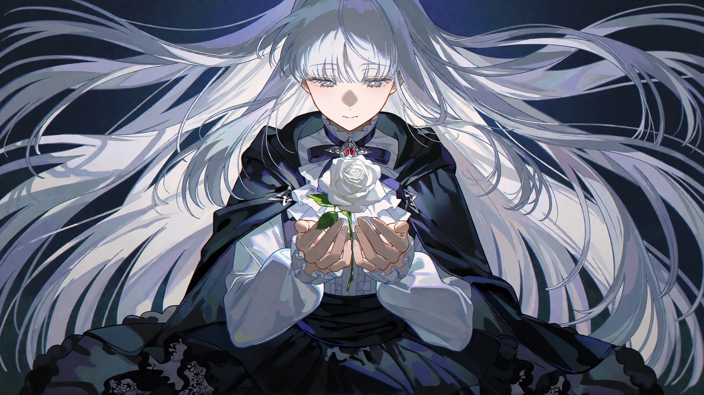
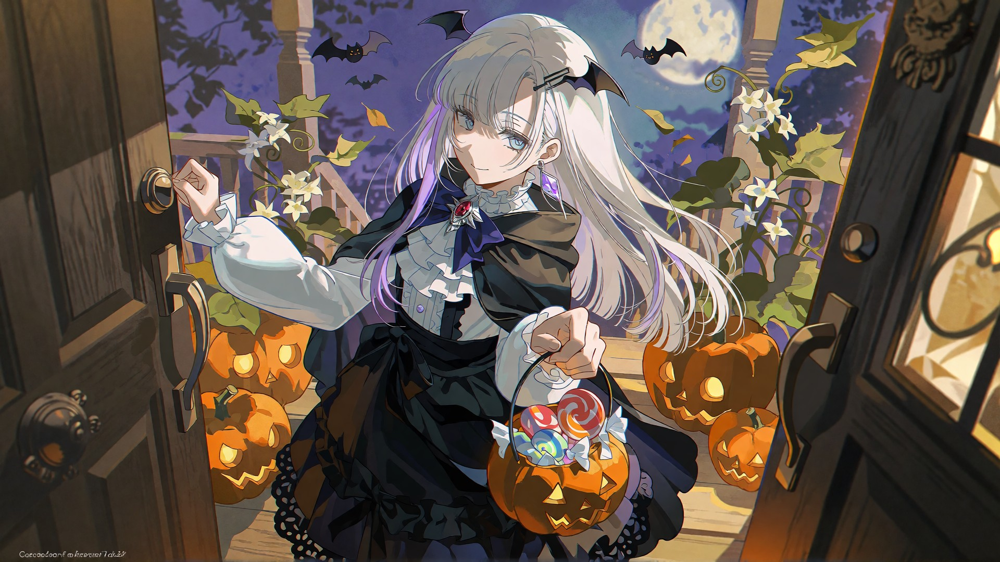
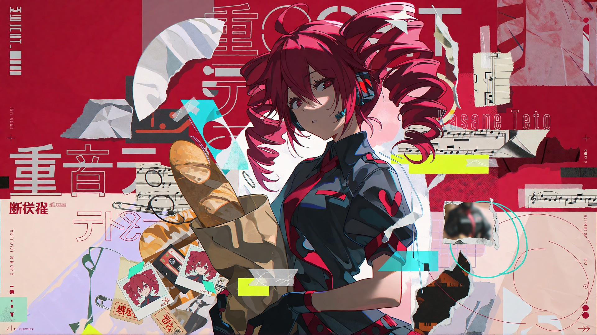
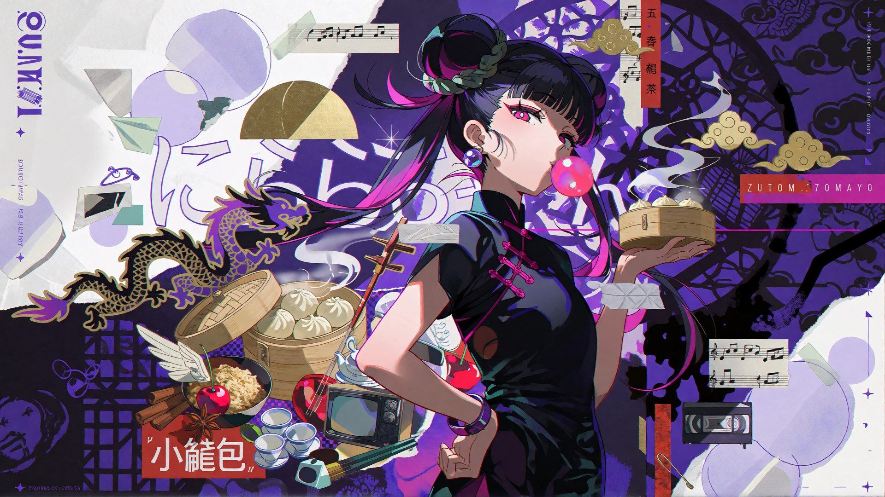
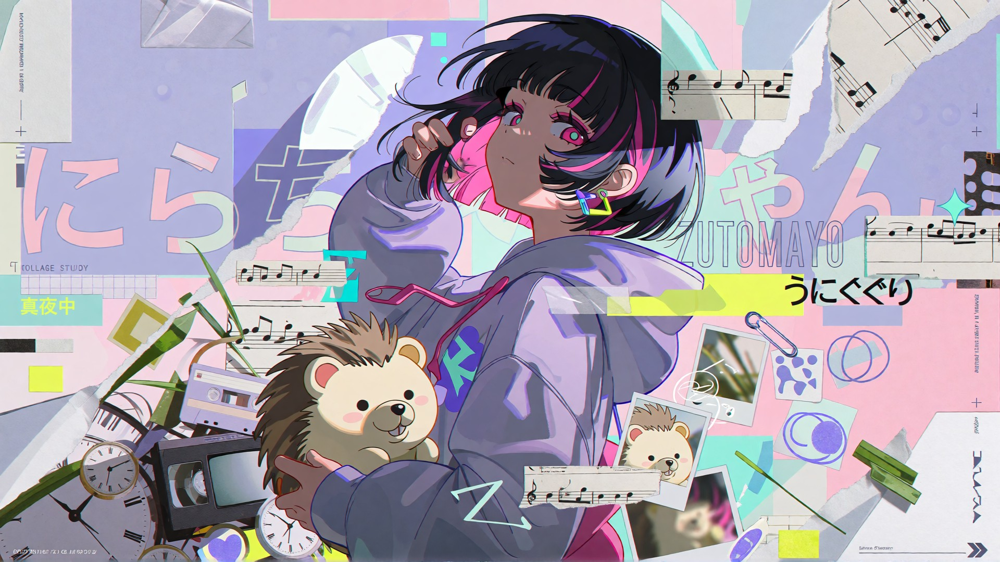
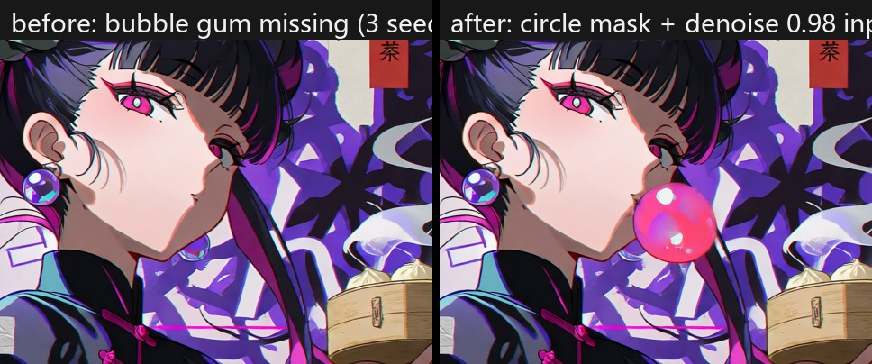

# Gallery

Everything below was rendered on the reference machine (RTX 3060 Laptop 6 GB) with the workflows shipped in this repo. All four use the same recipe unless noted: **Krea 2 Turbo Q4 GGUF, 10 steps er_sde / simple, CFG 1 (no negative prompt), 1920×1080 single pass.**

| Image | Subject | Recipe |
|---|---|---|
|  | Original character "Nightko", white-rose scene — the author's detail-baseline render of this character | z3zz4 LoRA @ 0.95, Krea 2 Turbo |
|  | Original character "Nightko" (user's own OC), trick-or-treat scene | z3zz4 LoRA @ 0.95, seed 1234 |
|  | Kasane Teto, collage-poster look with readable text | z3zz4 LoRA @ 0.95, seed 3120095504871 |
|  | Nira-chan (ZUTOMAYO), purple-black Chinese collage poster (anime-collage-poster skill) + bubble gum added by local fix | z3zz4 LoRA @ 0.95, base seed 1234; bubble: masked inpaint denoise 0.98, seed 202 |
|  | Nira-chan, pastel hoodie collage poster (anime-collage-poster skill), hand fixed locally after picking | z3zz4 LoRA @ 0.95, seed 20261030 |

## The pick-and-fix loop in one picture

The bubble gum was in the brief but dropped by all three full renders. Instead of re-rolling, a circle mask (r ≈ 54 px) went in front of the lips with a one-line prompt at denoise 0.98; one of three seeds drew a convincing bubble; `composite_mask.py` pasted it back so the rest of the image stayed pixel-identical.

The full file-by-file worked example is [../skills/anime-illustration/examples/nira_china_bubble_fix](../skills/anime-illustration/examples/nira_china_bubble_fix/README.md).

## Fan-art note

Kasane Teto is a free-to-use fan character (UTAU); ZUTOMAYO character art here is unofficial fan art. This project is not affiliated with Krea, AME/ZUTOMAYO, or any of the original creators.
