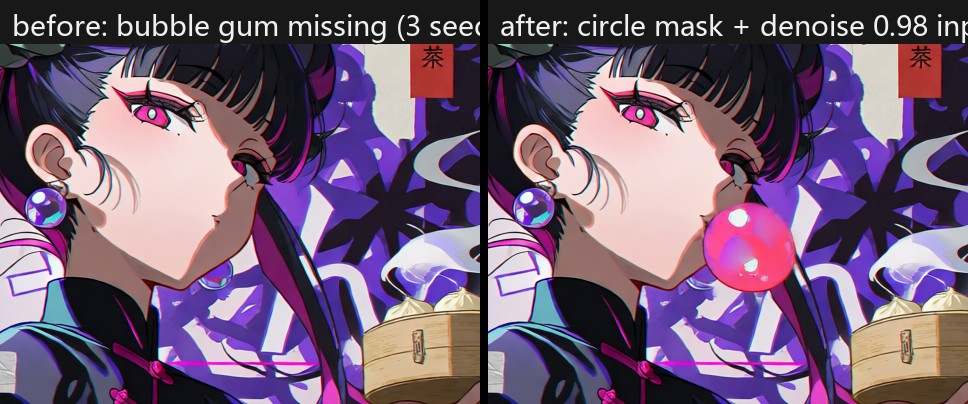

# Worked example: adding the missing bubble gum with a masked local inpaint

**The situation:** the brief asked for Nira-chan blowing a bubble-gum bubble. Full 1920×1080 renders dropped the prop in all 3 seeds — small props vanish easily from long prompts ([why](../../references/prompting-krea2.md)).

**The fix:** instead of re-rolling the whole picture, a masked inpaint redrew only the mouth region, and `composite_mask.py` pasted just that region back, leaving everything else pixel-identical.



## Files

| File | What it is |
|---|---|
| `final_without_fix.jpg` | The picked render (seed 1234) — no bubble anywhere |
| `bubble_mask.png` | Circle mask (r ≈ 54 px at 1920×1080) in front of the lips, feathered ~5 px |
| `bubble_prompt.txt` | Short prompt describing only the region: the glossy pink bubble, its size and position, the lips and chin around it |
| `bubble_inpaint_workflow_api.json` | The local-inpaint workflow with the prompt and denoise 0.98 baked in |
| `inpaint_raw.jpg` | Raw ComfyUI output of that inpaint (seed 202) — note the rest of the frame drifted slightly, which is why the paste-back step exists |
| `best.jpg` | Final composite: mask region taken from the inpaint, everything else from the picked render |

(This demo folder stores JPEGs to keep the repo small; a real preset folder produced by `freeze_preset.py` keeps lossless PNGs.)

## The commands

```
python scripts/run_workflow.py examples/nira_china_bubble_fix/bubble_inpaint_workflow_api.json \
    --prompt-file examples/nira_china_bubble_fix/bubble_prompt.txt \
    --image final_without_fix.jpg --mask bubble_mask.png \
    --denoise 0.98 --seed 202 --prefix bubble --upload

python scripts/composite_mask.py final_without_fix.jpg <comfy-output>/bubble_00001_.png \
    bubble_mask.png best.png
```

`composite_mask.py` prints the changed-pixel box — check that it sits inside the mask. Of 3 seeds, 1 drew a convincing bubble; the others redrew the lips without it. That hit rate is normal for small props: render 2–3 seeds and pick.

## Why not just prompt harder?

Re-prompting re-lays out the whole picture even with the same seed. The masked-inpaint path keeps the image the user already liked. More recipes: [references/local-fixes.md](../../references/local-fixes.md).
